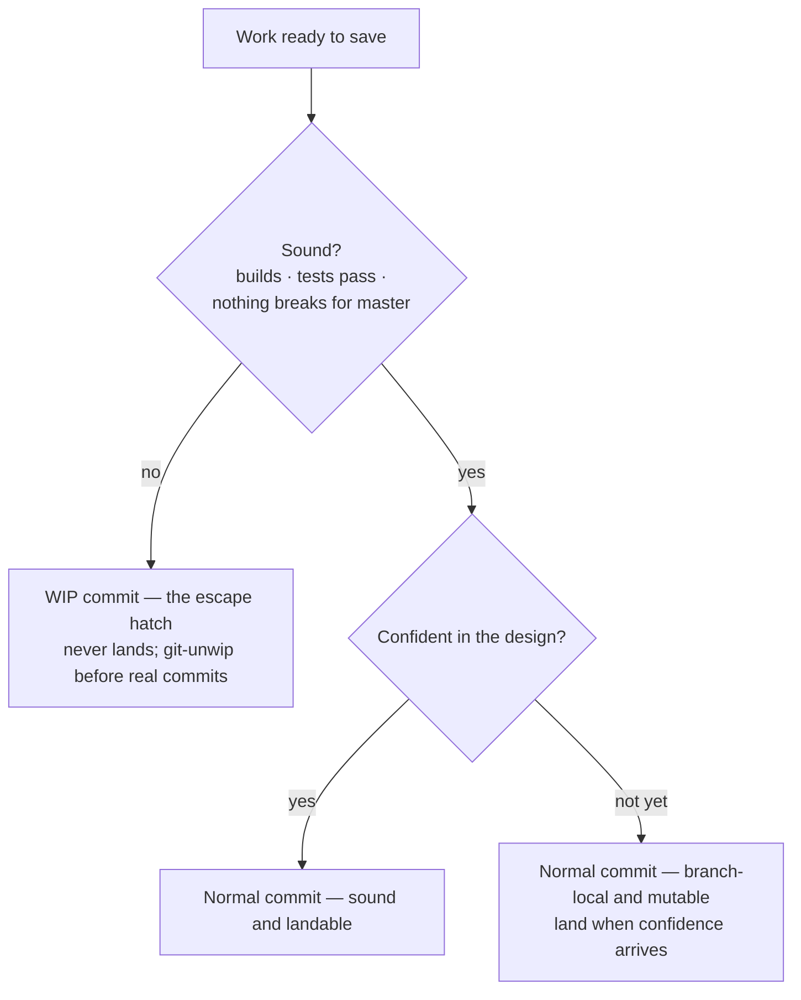
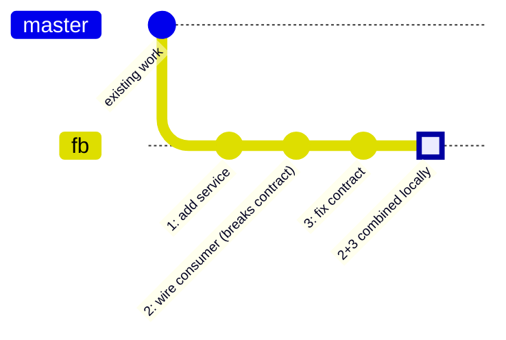
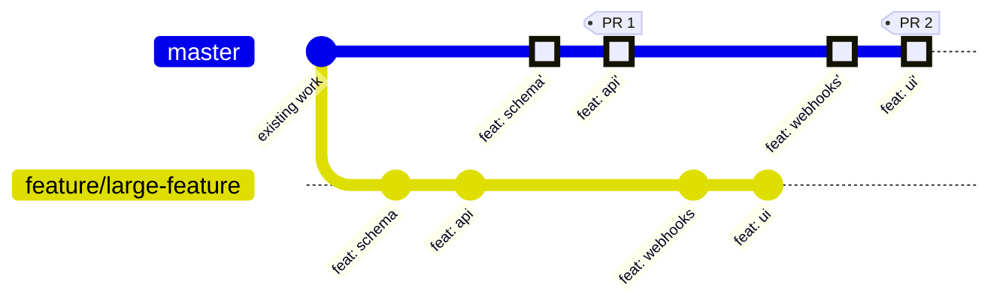
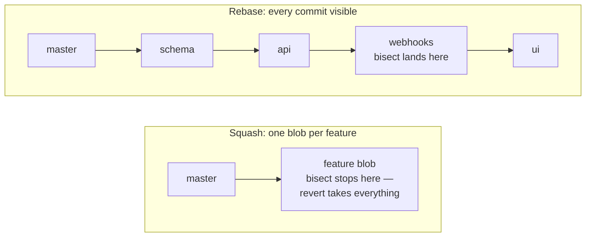
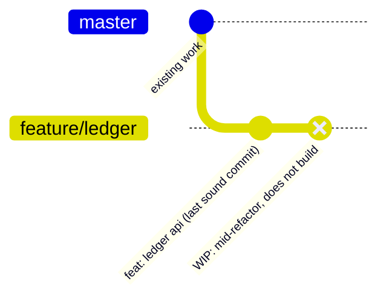
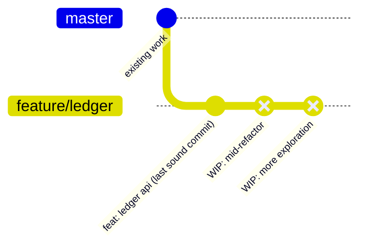
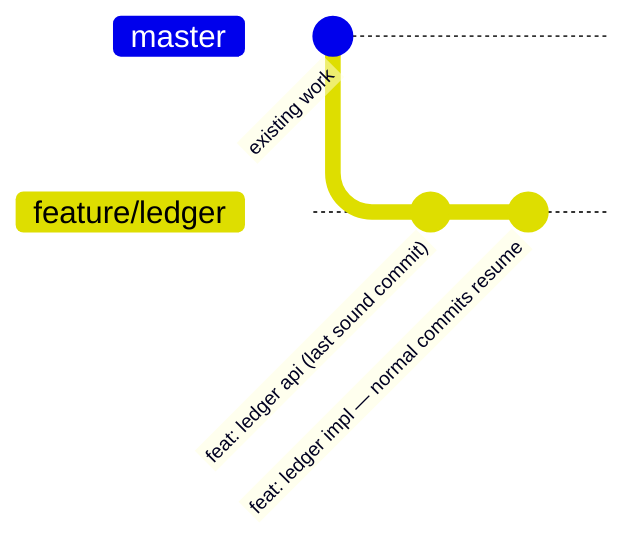

# Rebase Commit Guide

This guide explains how to work day-to-day under the rebase merge policy: how
to shape commits, when to land them, how to handle the situations that come up
in real feature work, and what the policy costs and how to mitigate that cost.

The **rules** live in [Commit Conventions](Commit-Conventions.md) — commit
types, breaking-change handling, WIP rules, and the merge policy itself. This
guide does not restate them; it teaches the judgment that surrounds them. When
this guide and the conventions document disagree, the conventions document
wins.

## Why rebase merges

Under rebase merge, every commit on a feature branch lands on `master` as its
own unit, in order, preserving its identity. The alternative — squash merge —
collapses a branch into one averaged commit at merge time. The difference is
not cosmetic; it changes how work is integrated, traced, and released.

**Integration frequency is decoupled from feature size.** With squash, a branch
has exactly one merge point: its end. If the team wants frequent integration
(and it should — frequent integration is how problems are found early), squash
forces features to be small, because the only way to merge often is to cut
many small branches. A feature that naturally takes two weeks gets unnaturally
split into two "features" to feed the pipeline. Rebase removes that coupling:
a long-lived branch can land a ready prefix at any time (see
[Partial merges](#scenario-part-of-the-branch-is-ready-the-rest-is-not)) while
the rest of the work continues.

**History stays traceable.** Every landed commit is a first-class deliverable.
A regression traces to the commit that introduced it with `git bisect`, and
`git revert` undoes exactly one change. A squash blob averages five commits
into one message; bisect can only point at the blob.

**Branch history becomes a progress signal.** Under squash, branch commits are
throwaway — the only thing that matters is the final squash. Under rebase
discipline, branch commits are *mostly final*: they are built to land as-is.
That makes branch history readable as progress before anything merges — by a
human skimming the log, or by tooling deriving status from it. The honest
caveat: "mostly final" is not final — fixups and pre-merge restructuring add
noise, so treat it as a leading indicator, with ground truth being what
actually lands.

**Releases follow from cheap merging.** The benefit is not changelog
formatting — five commits arriving in one pull request produce one release
either way. The benefit is systemic: rebase makes merging cheap (no
all-or-nothing feature boundary), so merging happens more often, and more
frequent merging means more frequent, smaller, more focused releases.
Semantic-release alignment still helps: each conventional commit inside a
release was authored when the work happened, not averaged into one message at
merge time.

### Why not merge commits

Merge commits are the third option. They preserve per-commit identity — some of
rebase's traceability benefit — and they avoid squash's rewrite of history. We
do not use them as the standard, because of what they do to the history itself:

- **Every sync braids in noise.** Each time a branch takes a mid-flight merge
  from `master`, a merge bubble enters history that has nothing to do with the
  work — an artifact of *when* you synced, not *what* you built. Long branches
  accumulate bubbles nobody authored and nobody needs.
- **The history stops being what the work was.** After braiding, the commit
  graph records the mechanics of branch bookkeeping rather than the shape of
  the work. Reading it requires graph tooling; the topology is not what the
  work originally was.
- **Reverting a merge is a landmine.** `git revert -m 1 <merge>` reverts the
  merge, but re-merging that branch later silently resurrects the reverted
  work unless the branch is rebased away first. Squash and rebase landings
  have no such trap.

Merge commits buy per-commit traceability and pay for it in topology: they sit
between squash and rebase and inherit problems from both. The policy chooses
the linear extreme — every commit lands individually, and `master`'s history
reads, start to finish, as the sequence of work that actually happened.

## The two axes: soundness and confidence

Most confusion about "when may I commit" comes from blurring two independent
questions. Separate them and the policy becomes mechanical:

| Axis | Question | Gates |
| --- | --- | --- |
| **Soundness** | Does it compile, pass tests, and not break `master` as it lands? | Whether a commit may exist on the branch |
| **Confidence** | Is this the design I would bet on? | When the commit should land |

A commit must always be **sound** — this is what "individually mergeable" means
(see [Commit Conventions](Commit-Conventions.md#the-master-relative-type)). A
commit does **not** need to be final-word on design to exist on the branch.

Confidence controls *landing*, because landing starts a mutability clock. A
branch-local commit can be reshaped, reordered, or rewritten for free before it
lands. Once landed, changing that API surface is a breaking change on `master`
— semver majors, downstream churn. So the doctrine is:

> **Land at the grain of confidence; keep the rest branch-local and mutable
> until implementation votes on the design.**

Committing stubs whose API you are not yet sure of is *legal and normal* — they
are sound, and "mostly final" never meant "final word". What is not legal is a
commit that is unsound: does not build, breaks tests, or would break `master`.

## Scenarios

The situations below cover the common cases. Each states what happens and why.

### Scenario: a feature that is naturally large

A feature will take two weeks. Under squash, that is pressure to split it into
artificially small features so integration stays frequent. Under rebase, the
feature keeps its organic size: commits land from the branch as slices become
sound and confidence-worthy, and the branch lives until the feature is done.
The unit of integration is the commit, not the feature.

### Scenario: an early commit turned out wrong

Commit 2 of a planned 6 broke an internal contract, and commit 3 fixed it.
If both landed, `master` would momentarily carry a broken state. The fix
happens **before merge, on the branch**: amend the original commit, or locally
squash the pair into one sound commit. Introduce-then-reverse pairs must never
reach `master` — this is a hard rule in
[Commit Conventions](Commit-Conventions.md#breaking-changes).

This is the practical meaning of "the branch is mutable": mistakes made on the
branch are fixed by reshaping history *before* landing, so the mistake never
existed from `master`'s point of view. The graph below shows the branch as it
must look at merge time — commits 2 and 3 combined into one sound commit:

### Scenario: part of the branch is ready, the rest is not

Half the branch is sound and settled; the rest is experimental. Land the ready
prefix as its own pull request and keep working on the branch — no new branch
to cut, no reconciliation when the PR merges, because the landed commits *are*
the branch's commits. Under squash this is impossible: the whole branch is one
blob, so it is all-or-nothing.

Gold prime-marked commits are the landed copies — same message, new commit id,
which is what a rebase produces (the branch line ends: deleted after PR 2
merges). No merge bubbles: under rebase merge, none are created.

### Scenario: stubs landed, implementation falsified the API

Stubs with a tentative API landed last week; implementation revealed the API
needs a breaking change. This is not a failure of the policy — it is the
confidence axis doing its job, one step later than hoped. The breaking change
is real now and is handled as the conventions require: declared with `!` or a
`BREAKING CHANGE:` footer, and downstream callers are updated. The lesson to
carry forward: if API confidence is genuinely low, keep the stubs branch-local
longer (sound commits, unlanded) rather than landing them early.

### Scenario: you need to save unfinished work

You are mid-change, the state is unsound (does not build), and you need to
switch context, move machines, or checkpoint before experimenting. Normal
commits would be unsound, and unsound commits must not enter the branch. This
is what WIP commits are for — see [The escape hatch: WIP commits](#the-escape-hatch-wip-commits).

### Scenario: a regression appears on `master`

Because every commit landed individually, `git bisect` walks single commits and
finds the exact one that introduced the regression; `git revert <sha>` undoes
precisely that change without touching its siblings. Under squash, bisect
stops at the feature blob and revert takes the whole feature with it.

### Scenario: a mid-branch commit conflicts with `master`

During the rebase, `master` has moved and commit 3 of 7 conflicts. There is no
squash-around-it escape under this policy — resolve at commit 3: fix, `git
add`, `git rebase --continue`, repeat for any further conflicts. `git rebase
--abort` returns the branch to its pre-rebase state if it goes sideways. The
full recovery sequence is in [Workflow](Workflow.md#merge-policy). This is the
sharpest operational cost of the policy; see
[The costs, honestly](#the-costs-honestly).

### Scenario: two people share one branch

Rebasing onto `master` rewrites branch history, so a shared branch needs
`--force-with-lease` discipline and coordination after every rewrite. The
policy's answer is structural: branches have one owner. AI sessions in this
workspace do not share branches with humans by construction. If a branch must
be shared, treat every rebase as a broadcast event.

## The escape hatch: WIP commits

Sometimes work must be committed to be saved, but it is unsound — mid-refactor,
does not build, pure checkpoint. The `WIP:` commit exists for exactly this and
nothing else. `git-wip` creates one (staging everything, bypassing normal
commit gates by design); `git-unwip` soft-resets back to the last real commit,
returning the work to the staging area.

The constraints, all enforced or conventional:

- WIP commits **never reach `master`** — the merge tooling hard-rejects any
  merge range containing one. They also carry no `Change-Id`, by design.
- Only a WIP commit may follow a WIP commit. A normal commit on top of a WIP
  commit is blocked by the pre-commit hook until `git-unwip` restages the work.
- A WIP commit maps to nothing: it counts toward no plan, no progress view,
  no changelog.
- A pushed WIP commit still travels — moving between machines works, because
  `git-wip` pushes the snapshot.

Honest limits, stated plainly: **there is no tooling that ages out a stale WIP
commit** — "do not keep a branch parked on WIP for days" is a norm, enforced by
review attention, not by a script. And the hatch is protected socially: if it
becomes a routine parking lot for work that should be real commits, the team
loses it. Use it for the extraordinary case it was built for; treat a WIP
commit older than a day or two as a smell.

The lifecycle, shown as the branch history itself (the same convention as the
rest of this guide: `REVERSE`-styled commits are the WIP snapshots; gold
commits are sound work):

**Step 1 — save where you are.** Mid-refactor, nothing builds, and you need to
move machines. `git-wip` snapshots the mess as a `WIP:` commit and pushes it —
your work now exists somewhere other than a laptop about to be closed:

**Step 2 — stack more saves if needed.** Only a WIP commit may follow a WIP
commit (the hook enforces this), so saves stack freely — a real commit cannot
enter until the stack is unwound:

**Step 3 — `git-unwip`: the stack evaporates.** Back at the desk, `git-unwip`
soft-resets to the last real commit. The WIP commits vanish from history and
their content returns to the staging area — invisible in the graph below,
deliberately, because uncommitted work is not history. That is the point: it
cannot merge, cannot pollute the log, cannot be built on by accident. Normal
sound commits resume on top:

## The costs, honestly

A policy that claims no costs is selling something. These are real; each has a
mitigation.

| Cost | What it means | Mitigation |
| --- | --- | --- |
| **CI verifies the tip, not every commit** | A PR with 6 commits is tested as a whole; individual mergeability is a policy guarantee, not a CI-verified one. A middle commit could in principle be unsound. | Accept policy-level assurance (the default), or pay for a merge queue that tests each commit. The policy chooses the former: the discipline of building sound commits is the verification. |
| **Mid-stack conflicts** | Commit 3 of 7 conflicts must be resolved at commit 3 — no squash-around escape. | Keep commits small and focused (small surface area, fewer collisions); rebase onto `master` often so drift stays small; the recovery sequence is documented in [Workflow](Workflow.md#merge-policy). |
| **Hygiene must exist before landing** | Deferred hygiene compounds: five sloppy commits is a five-minute fixup session; twenty-five is archaeology. | Best practice is clean-at-creation (see below), with interactive rebase as the correction tool, not the plan. |
| **Shared-branch rewrites** | Rebase rewrites history; two owners means force-push coordination. | One-owner branches. Treat a shared branch as an exception with explicit coordination. |
| **Learning curve** | Committing atomically means *ordering* work: schema lands before the code that uses it, config before its consumer. That is a skill, not a toggle. | Expect it to feel slower for the first weeks. Pair on the first few commits; review branch history explicitly. |
| **Throwaway scaffolding** | Committing in smaller units can force temporary code: tests for stubs that assert "not yet implemented", placeholders that bring a commit up to gate. | See the decision table below; most of the time the scaffold is avoidable by choosing the commit grain well, and what remains is cheap to delegate to AI tooling. |

### The throwaway-tests question

A stub-only commit can raise a hard question: if a coverage gate applies per
commit, stubs need tests, and tests asserting "not implemented yet" are
throwaway. There are three honest answers, and the right one depends on the
situation — not one universal rule:

| Situation | Choice | Why |
| --- | --- | --- |
| Implementation is too large to share the commit, and nothing external depends on the stubs yet | **Batch: stub + first real usage in one commit** | Eliminates the scaffold entirely. Often the best commit shape anyway. |
| Downstream consumers need the API now to unblock | **Stubs-only commit, with minimal placeholder tests** | Unblocking others is worth temporary tests; write the cheapest that satisfy the gate. |
| The gate itself is making things worse | **Scope the gate at the merge-unit level, not per commit** | Coverage targets are a means; if per-commit enforcement manufactures garbage, the enforcement grain is wrong. |

The general target: **the smallest commit that stands alone.** Smaller than
that, and you are manufacturing scaffolding to satisfy yourself. Bigger, and
you are drifting back toward squash economics — larger, less traceable units.

## Best practices

- **Think about the commit at creation time, not at PR time.** Git permits
  deferred restructuring; the policy requires only *clean before landing*. The
  reason to prefer clean-at-creation is economic: deferred hygiene compounds.
  Treat interactive rebase as a correction tool, not the plan.
- **Aim for the smallest commit that stands alone.** It should make sense in
  isolation: self-contained subject, self-contained change, type true as seen
  from `master` (see [Commit Conventions](Commit-Conventions.md#the-master-relative-type)).
- **Order work so dependencies land first.** Schema before consumer, config
  before reader, interface before implementation. If a commit cannot be
  ordered into standing alone, that is a signal to re-cut it, not to relax.
- **Rebase onto `master` early and often.** Small drift means small conflicts.
- **Keep WIP commits rare and short-lived.** They are a checkpoint mechanism,
  not a workflow.
- **When unsure whether to land, ask the confidence question.** "Would I want
  to build the next thing on this design?" Yes → land. Not yet → keep it
  branch-local and mutable.
- **Let tooling carry the hygiene load.** Commit-skill workflows assess atomicity
  and suggest splits; AI delegation can produce the temporary tests a stub
  commit needs. The policy's cost is attention, and attention can be augmented.

## Where the rules live

- [Commit Conventions](Commit-Conventions.md) — the canonical contract:
  master-relative types, breaking changes, WIP rules, merge policy.
- [Workflow — Merge policy](Workflow.md#merge-policy) — delivery-flow
  consequences and the conflict recovery sequence.
- [Workflow](Workflow.md) — the session and delivery flow these commits feed.
- [Additional Tooling — WIP commits](Additional-Tooling.md#the-wip-commit-convention) —
  `git-wip` / `git-unwip` usage, the recovery ref, and the `⚡WIP` prompt marker.
